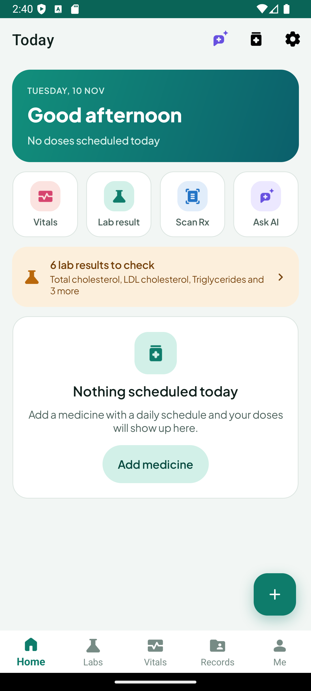
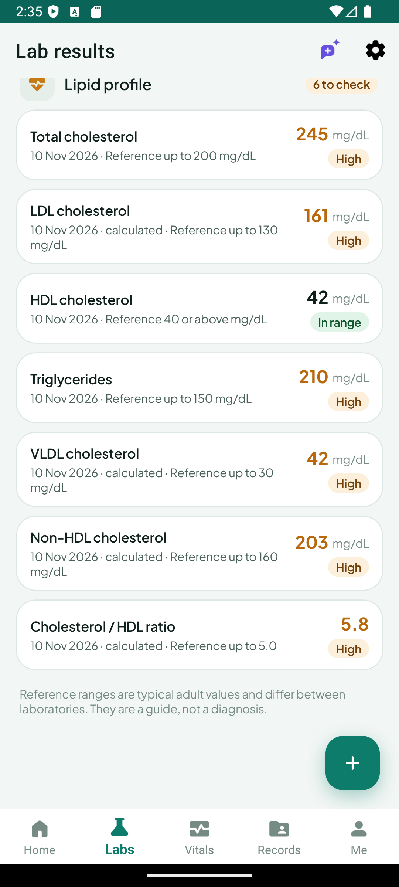
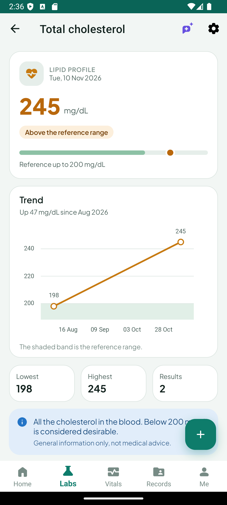

# Chartwell

Your health chart, kept well. Chartwell is a private, offline-first personal health app for Android,
built with .NET MAUI. It keeps medicines, lab results, vitals, reports and doctor visits on your own
phone. There is no account and no Chartwell server.

<p>
  
  
  
</p>

> **Not a medical device.** Chartwell records what you enter and compares it with typical adult
> reference ranges, which differ between laboratories. It does not diagnose, and nothing in it is
> medical advice. Talk to a clinician about your results.

## Features

| Area | What it does |
| --- | --- |
| **Home** | Today's doses with Take / Snooze straight from the notification, quick actions, lab results that need a look, and the next follow-up visit. |
| **Medicines** | Schedules, courses, stock, adherence, refill nudges, auto-logged missed doses, and a home-screen widget. |
| **Labs** | About 100 built-in tests in 13 panels: lipid profile, kidney and liver function, blood sugar, CBC, thyroid, electrolytes, vitamins, heart and inflammation markers, urine routine, and positive/negative tests (HBsAg, Anti-HCV, HIV, dengue and more). Reference ranges by sex, entry in mg/dL or mmol/L, your own custom tests, trend charts with the reference band, and derived values (LDL, VLDL, non-HDL, eGFR and others). |
| **Vitals** | Weight, blood pressure, heart rate, blood sugar, SpO₂ and temperature, with status chips, sparklines, history charts and a BMI meter. |
| **Records** | Reports as photos or PDFs with on-device OCR, doctor visits with follow-up reminders, and a merged timeline. Lab values can be imported from a scanned report. |
| **Me** | Health profile (age, sex, blood group, height), allergies, conditions and an emergency contact. |
| **Assistant** | Optional chat over your own records, using your own Gemini API key. |
| **Export and backup** | PDF health report, local ZIP export/restore, and optional automatic backup to a hidden folder in your own Google Drive. |
| **Security** | PIN lock with fingerprint or face unlock. |

Light and dark themes are included.

## Privacy

- All data is stored on the device: a SQLite database plus files in the app's private data folder.
- The app makes network requests in two cases only, and both are off until you set them up:
  - **AI features** send the text or images you ask about to Google's Gemini API, with the API key
    you provide.
  - **Google Drive backup** uploads one ZIP to the hidden `appDataFolder` of the Google account you
    sign in with. The only Drive permission requested is `drive.appdata`.
- The Gemini key, OAuth tokens and the PIN are kept in Android secure storage.
- The repository contains no API keys or OAuth client ids; `Constants/CloudConstants.cs` ships with
  placeholders.

## Requirements

- Windows with [.NET SDK 9.0.3xx](https://dotnet.microsoft.com/download/dotnet/9.0)
  (`HealthTracker/global.json` pins it)
- The .NET MAUI Android workload: `dotnet workload install maui-android`
- Android SDK (API 35 or later) and, for running, an emulator or a device with Android 6.0 (API 23) or later
- Optional: Visual Studio 2022 with the .NET MAUI workload

## Build and run

The solution, namespaces and folders keep the original `HealthTracker` name; only the product is
called Chartwell.

```powershell
# Build (name the csproj: the .sln also contains the test project, which has no Android target)
dotnet build HealthTracker/HealthTracker.csproj -f net9.0-android "-p:AndroidSdkDirectory=<path to your Android SDK>"

# Build and install on the connected device or running emulator
dotnet build HealthTracker/HealthTracker.csproj -f net9.0-android -t:Install -p:EmbedAssembliesIntoApk=true "-p:AndroidSdkDirectory=<path to your Android SDK>"

# Unit tests (no Android SDK or MAUI workload needed)
dotnet test HealthTracker.Tests/HealthTracker.Tests.csproj
```

From Visual Studio 2022, open `HealthTracker/HealthTracker.sln`, pick a device and run.

## Optional setup

- **AI features**: Settings → AI assistant → paste a Gemini API key (free at
  [aistudio.google.com](https://aistudio.google.com)). Without a key, report and prescription
  scanning fall back to on-device OCR.
- **Google Drive backup**: needs a one-time OAuth client for your own build. Follow
  [`docs/CLOUD_SETUP.md`](docs/CLOUD_SETUP.md). Without it, the Settings card reports cloud backup as
  not configured and local ZIP backup still works.

## Project layout

```
HealthTracker/                 the app (net9.0-android)
  Constants/                   lab catalog, metric types, cloud constants
  Models/  Repositories/       SQLite entities and typed queries (sqlite-net-pcl)
  Services/                    business logic: medicines, labs, metrics, reports, reminders,
                               AI (Services/Ai), Drive backup (Services/Cloud), PDF (Services/Pdf)
  ViewModels/  Views/          MVVM pages (hand-written INotifyPropertyChanged, no MVVM toolkit)
  Controls/                    custom drawn controls (BMI gauge, sparkline, tinted image)
  Resources/                   themes (light/dark tokens), styles, fonts, SVG icons
  Platforms/Android/           widget, biometric prompt, OAuth callback, manifest
HealthTracker.Tests/           xUnit tests; links the app's MAUI-free sources
docs/                          design system, cloud setup, screenshots
```

Stack: .NET MAUI 9, CommunityToolkit.Maui, sqlite-net-pcl, LiveCharts2, SkiaSharp (PDF export),
Plugin.LocalNotification, Plugin.Maui.OCR, PdfPig, Google Drive API.

## Documentation

- [`PROJECT_LOGIC_DOCUMENTATION.md`](PROJECT_LOGIC_DOCUMENTATION.md): every service and ViewModel explained.
- [`docs/DESIGN_SYSTEM.md`](docs/DESIGN_SYSTEM.md): brand, UI tokens, styles and page rules.
- [`docs/CLOUD_SETUP.md`](docs/CLOUD_SETUP.md): Google Drive backup setup.
- [`docs/ARCHITECTURE.md`](docs/ARCHITECTURE.md): architecture notes, build commands and conventions.
- [`CONTRIBUTING.md`](CONTRIBUTING.md): how to make and check a change.

## Third-party assets

Plus Jakarta Sans (SIL Open Font License 1.1) and Material Symbols (Apache License 2.0). See
[`THIRD-PARTY-NOTICES.md`](THIRD-PARTY-NOTICES.md).

## License

Copyright (C) 2026 Nasif Ishtiaque Islam

Chartwell is free software: you can redistribute it and/or modify it under the terms of the
GNU General Public License as published by the Free Software Foundation, either version 3 of the
License, or (at your option) any later version. It is distributed in the hope that it will be
useful, but WITHOUT ANY WARRANTY; without even the implied warranty of MERCHANTABILITY or FITNESS
FOR A PARTICULAR PURPOSE. See [`LICENSE`](LICENSE) for the full text.

Bundled fonts and icons keep their own licences, listed in
[`THIRD-PARTY-NOTICES.md`](THIRD-PARTY-NOTICES.md).
